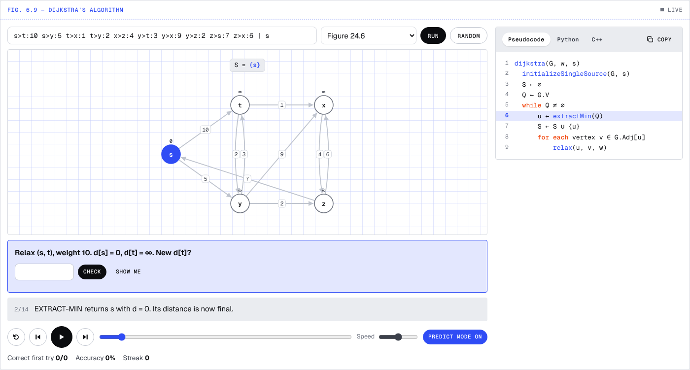
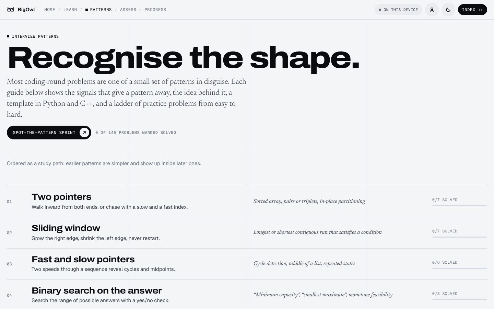

# BigOwl

**Learn data structures and algorithms by watching them run, and predicting the next step.**

[](https://github.com/pranaysharma13/BigOwl/actions/workflows/ci.yml)
[](LICENSE)
[](LICENSE-CONTENT)

**Live site → [bigowl.vercel.app](https://bigowl.vercel.app)**


BigOwl follows the structure of *Introduction to Algorithms* (Cormen, Leiserson, Rivest and Stein, 3rd ed.). Every topic has an original explanation and a step-by-step figure you can play, rewind and scrub. Turn on **predict mode** and the figure stops at each decision point and asks what happens next.

## Features

| | |
|---|---|
| **Learn** | 63 topics in 8 units, from asymptotic notation to FFT and NP-completeness. Each has theory, a step-through figure, code in pseudocode, Python and C++, a concept check, and a random practice drill. |
| **Patterns** | 21 coding-interview patterns (two pointers, sliding window, monotonic stack, …), each with recognition signals, templates, a walkthrough or linked theory, and a ladder of 145 LeetCode problems in total that you can tick off. |
| **Assessments** | A timed mock paper (concepts, code tracing, bug spotting, pattern recognition, complexity), a 60-second pattern sprint, a complexity drill, and put-the-lines-in-order problems. |
| **Progress** | Mastery per topic, streaks, prediction accuracy and score history. Saved in the browser and synced to your account after email sign-in. Export or delete everything at any time. |

<table>
  <tr>
    <td></td>
    <td></td>
  </tr>
  <tr>
    <td align="center"><sub>Dijkstra's algorithm in predict mode</sub></td>
    <td align="center"><sub>Interview patterns</sub></td>
  </tr>
</table>

## Stack

- **Front end:** Vite, React 19, TypeScript (strict), React Router 7, Zustand
- **Visualizer engine:** framework-free JavaScript that records each algorithm as replayable frames
- **Back end:** Supabase (email magic-link sign-in, Postgres with row-level security)
- **Hosting:** Vercel, with a strict Content Security Policy and security headers
- **Third-party runtime scripts:** none, with no analytics. Fonts are self-hosted.

## Project layout

```
src/
  app/            router and page shell (header, index menu, footer)
  pages/          one file per route (Home, TopicPage, Patterns, Assess, Account, ...)
  components/     small React pieces (Mount, Pill, FitText, icons)
  engine/         visualizer engine: frame recorder, step player, stage renderers, code panel, quiz
  content/        topics, patterns and question banks          (CC BY-NC 4.0)
  features/
    progress/     progress model (pure functions), store, hooks
    auth/         Supabase sign-in, sync, export and delete
    assess/       assessment question pools and scoring
  lib/            supabase client, theme, page title
  styles/         tokens.css, engine.css, app.css
supabase/migrations/   database schema and security policies
tests/                 Vitest unit tests
docs/screenshots/      images used in this README
```

## Run it locally

Requires Node 22 or newer (see `.nvmrc`).

```bash
npm install
cp .env.example .env.local      # then fill in the Supabase URL and anon key
npm run dev                     # http://localhost:5173
```

Without the two values in `.env.local`, the site still works fully; progress just stays in the browser and sign-in shows as not configured.

| Script | What it does |
|---|---|
| `npm run dev` | Development server with live reload |
| `npm run build` | Type-check and build to `dist/` |
| `npm run preview` | Serve the built site locally |
| `npm test` | Run the test suite |
| `npm run typecheck` | TypeScript checks only |
| `npm run lint` | ESLint |
| `npm run format` | Prettier |

## Testing

112 Vitest tests run on every pull request through GitHub Actions. They cover:

- **Every visualizer:** each one is run on its presets and on random inputs, and every checkpoint question is validated.
- **Known answers:** the drills and pattern walkthroughs are checked against expected results (for example the LU pivots, the Miller–Rabin verdicts and the van Emde Boas successors).
- **The assessment pool:** sizes, filters, no duplicate questions, and no equivalent answers offered as distractors.
- **The progress model:** merging two devices' progress, mastery scoring and streaks.

## Deployment

Merges to `main` deploy automatically to Vercel, and every pull request gets a preview link. The database schema and row-level security policies live in `supabase/migrations/`.

## Security and privacy

See [SECURITY.md](SECURITY.md) to report a vulnerability, and [COMPLIANCE.md](COMPLIANCE.md) for:
- what data is stored, and where
- the security measures in place
- accessibility
- licences

## License

- **Code:** [MIT](LICENSE). This covers everything except `src/content/`.
- **Educational content in `src/content/`:** [CC BY-NC 4.0](LICENSE-CONTENT). You may share and adapt it for non-commercial use, with credit.

All explanations, pseudocode, figures and questions are original. Section numbers point to the textbook so you can read along in your own copy. Problem names and numbers link to LeetCode; statements are not copied. BigOwl is not affiliated with MIT Press, the book's authors, or LeetCode.
